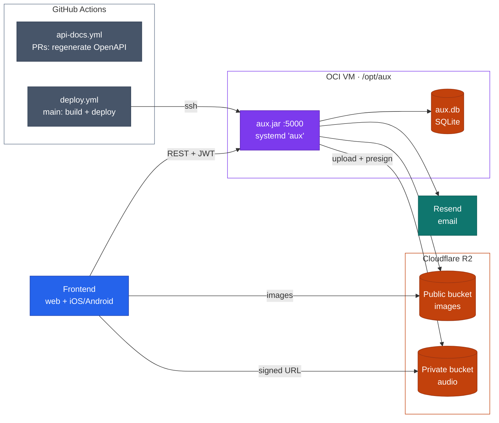
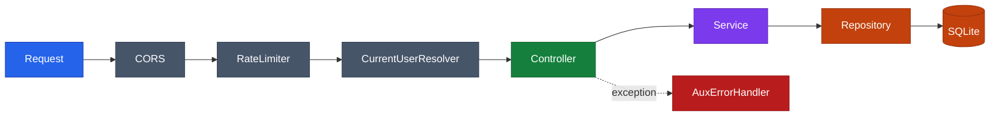
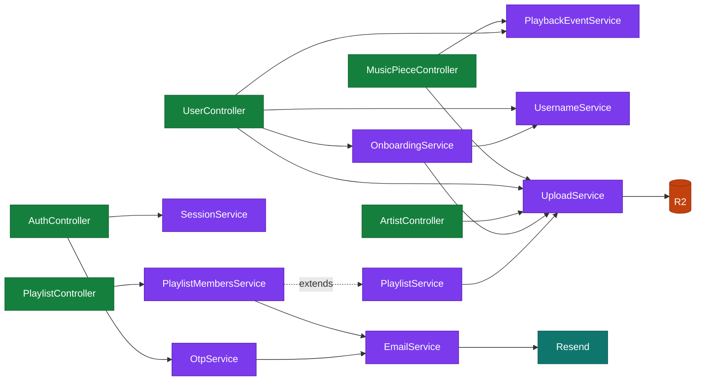
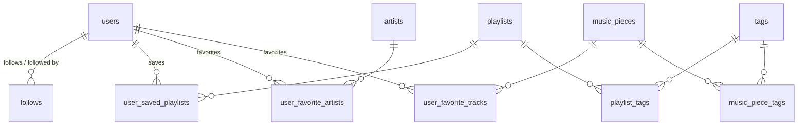

# Aux backend architecture

Spring Boot (Java 25) on port 5000, SQLite via Hibernate + Flyway, media in Cloudflare R2, email via Resend.

Colors: blue = client, green = controllers, purple = services / app, orange = storage, teal = external APIs, gray = CI and request filters, red = errors.

## 1. System and deployment

Secrets live in `/opt/aux/.env` on the VM. `deploy.yml` runs on pushes to `main` that touch `backend/**`.

## 2. Request pipeline

Every request passes these steps in order. Any exception ends up in `AuxErrorHandler`, which returns `AuxServerError` JSON.

| Step | What it does |
|---|---|
| CORS (`WebConfig`) | Allows any origin |
| `RateLimiter` | Per-IP token bucket: 120/min default, 10/min on `/api/auth/**`, 20/min for multipart uploads |
| `CurrentUserResolver` | Fills `@CurrentUser` / `@OnboardingUser` / `@OptionalCurrentUser` params: verifies the JWT, loads the user, blocks accounts that have not finished onboarding |
| `AuxErrorHandler` | Maps `AuxException`, validation, DB, and unexpected errors to `AuxServerError` |

## 3. Controllers and services

Repositories are left out to keep lines readable: every controller and service reads and writes SQLite through them. `CoreController` uses only repositories, so it is not shown. Controllers read repositories directly for simple lookups; services hold anything with rules or side effects.

| Controller | Base path | Covers |
|---|---|---|
| `AuthController` | `/api/auth` | Register, login, password reset, email change |
| `UserController` | `/api/users` | Onboarding, profile, settings, library, listening history |
| `CoreController` | `/api/core` | User list, top pieces, search |
| `ArtistController` | `/api/artists` | Artists, artist images, favorites |
| `MusicPieceController` | `/api/music-pieces` | List, upload, stream, report plays |
| `PlaylistController` | `/api/playlists` | Playlists, tracks, saves, members, invites, play queue |

| Service | Job |
|---|---|
| `SessionService` | Issues and verifies session JWTs (HS256, 1 hour) |
| `OtpService` | Email codes for password and email changes, stored as bcrypt hashes |
| `OnboardingService` | Walks new accounts through onboarding steps |
| `UsernameService` | Username rules, reserved names, `ProfanityFilter` |
| `PlaybackEventService` | Signed single-use play tokens; credits only listening time the server can bound |
| `PlaylistService` | Abstract base: visibility, tracks, saves, queue paging, seeded shuffle |
| `PlaylistMembersService` | Extends `PlaylistService`: invites, permissions, leaving |
| `UploadService` | Re-encodes images to WebP, strips MP3s to audio frames, R2 storage, signed audio URLs |
| `EmailService` | Sends mail through Resend |

Empty placeholder services (no code yet): `CompatibiltiyService`, `CreatorAnalyticsService`, `FavoritesService`, `GlobalStatsService`, `ListeningHistoryService`, `MediaIngestionService`, `PresenceService`, `RecommendationService`.

## 4. Playback flow

```mermaid
sequenceDiagram
    box rgba(37,99,235,0.15) Client
        participant C as Client
    end
    box rgba(21,128,61,0.15) Controllers
        participant PC as PlaylistController
        participant MC as MusicPieceController
    end
    box rgba(124,58,237,0.15) Services
        participant PB as PlaybackEventService
        participant U as UploadService
    end
    box rgba(194,65,12,0.15) Storage
        participant R2 as R2 audio
        participant DB as SQLite
    end

    C->>PC: GET /playlists/{id}/play
    PC->>DB: check access, read track order
    PC-->>C: page of piece ids + cursor
    C->>MC: GET /music-pieces/{id}/stream
    MC->>PB: issuePlayToken
    MC->>U: signedAudioUrl
    MC-->>C: signed URL + play token
    C->>R2: GET audio
    C->>MC: POST /music-pieces/{id}/plays
    MC->>PB: recordPlay
    PB->>DB: insert play_events
```

`recordPlay` credits only seconds that fit after the token was issued, within the piece's length, and after the user's previous play ended.

## 5. Data model

Flyway migrations: `V1__baseline.sql`, `V2__Public_ids.java` (adds a random base62 `public_id` to users, playlists, artists, and music_pieces), `V3__playlist_members.sql`.

### Core tables

```mermaid
erDiagram
    users ||--o| profile_details : has
    users ||--o| otp_codes : "pending code"
    users ||--o{ playlists : owns
    users ||--o{ music_pieces : uploads
    artists ||--o{ music_pieces : performs
    playlists ||--o{ playlist_tracks : contains
    music_pieces ||--o{ playlist_tracks : "in"
    playlists ||--o{ playlist_members : "shared with"
    users ||--o{ playlist_members : "member"
    users ||--o{ play_events : listens
    music_pieces ||--o{ play_events : played

    users {
        string user_id PK
        string public_id
        string username "unique, case-insensitive"
        string email
        string password_hash
        string onboarding_step
    }
    playlists {
        string playlist_id PK
        string public_id
        string owner_id FK
        bool is_public
        string playlist_name
    }
    music_pieces {
        string music_piece_id PK
        string public_id
        string uploader_user_id FK
        string artist_id FK
        string mp3_file_url "R2 key"
        int duration_seconds
        bool is_public
    }
    artists {
        string artist_id PK
        string public_id
        string artist_name "unique, case-insensitive"
        string created_by_user_id FK
    }
    playlist_tracks {
        string playlist_id PK
        string music_piece_id PK
        int playlist_position
    }
    playlist_members {
        string playlist_id PK
        string user_id PK
        string permission "LISTENER / EDITOR"
        string status "PENDING / ACCEPTED"
    }
    play_events {
        string play_event_id PK
        string user_id FK
        string music_piece_id FK
        string context_playlist_id FK
        int listen_duration_seconds
    }
```

`artists.created_by_user_id` points at `users`, and `play_events.context_playlist_id` at `playlists`; left out of the diagram to keep the lines readable.

### Social, favorites, and tags

All join tables, keyed by the pair of ids.

